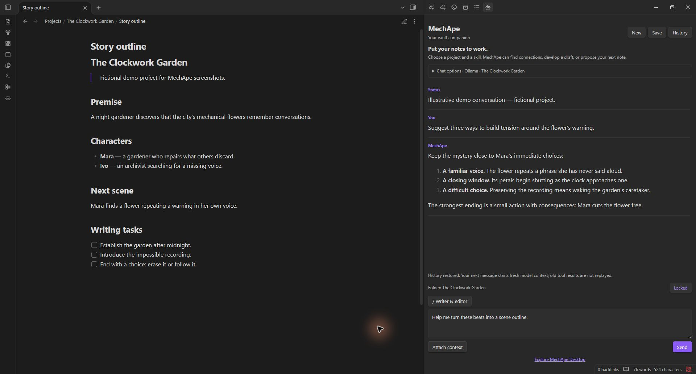
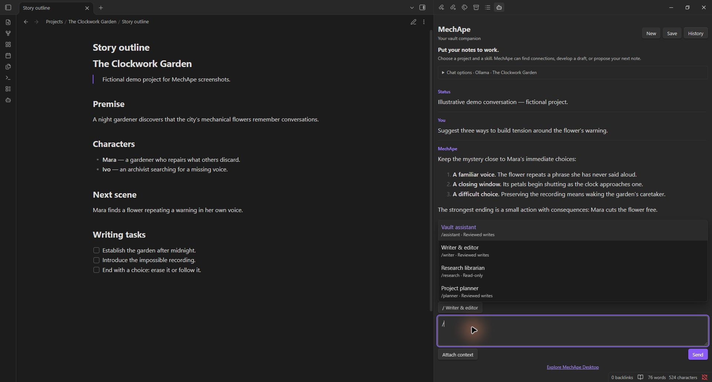

# MechApe for Obsidian

A free AI companion in Obsidian’s right sidebar. Connect Ollama, OpenRouter, Anthropic, or an OpenAI-compatible endpoint to find notes, develop drafts, and propose reviewed Markdown changes.

The free Obsidian edition of [MechApe](https://codalanguez.com/mechape/), by Coda Languez. The plugin works independently: no desktop purchase, subscription, activation, or MechApe account is required. Cloud-provider usage fees are separate. A static **Explore MechApe Desktop** link in the plugin promotes the author’s separate paid desktop product; it opens only when clicked.

**Version 0.1.7.** [View the Community directory listing](https://community.obsidian.md/plugins/mechape). Install manually from [GitHub releases](https://github.com/codalanguez/MechApe-Obsidian/releases). This release is desktop-only, requires Obsidian 1.14.5 or later, and does not include the experimental Image Studio bridge.

## Screenshots

Fictional demo project and illustrative conversation; no private vault content.





## Features

- Collapsible Chat options with searchable model and project pickers.
- Desktop streaming responses and a combined Send/Stop button; partial replies are kept after cancellation.
- `/` skill menu in the composer, with built-in and custom instruction profiles.
- Folder context from explorer selection or the **Use folder in MechApe** context-menu action.
- A visible note/folder context chip and project lock to prevent accidental scope changes while browsing.
- Local transcript and draft history, automatic restoration, and a searchable History dialog.
- Markdown note creation and updates with Apply/Reject review and concurrent-edit protection.
- Read-only skills, excluded folders, and an option to disable note tools.
- Explicit note attachment and Markdown transcript export with **Save**.

## Install and connect

1. Download `main.js`, `manifest.json`, and `styles.css` from the same release.
2. Copy them into `<vault>/.obsidian/plugins/mechape/` (use your configured vault configuration directory if different).
3. Reload Obsidian and enable MechApe under **Settings → Community plugins**.
4. In **Settings → MechApe**, configure your provider and API key if needed.
5. Open **MechApe: Open chat** from the command palette or robot ribbon button.
6. Expand **Chat options**, refresh models, and type to find your model. Choose a project folder to narrow access.

| Provider | Default API base URL | Credentials |
| --- | --- | --- |
| Ollama | `http://localhost:11434` | Usually no key |
| OpenRouter | `https://openrouter.ai/api/v1` | OpenRouter API key |
| Anthropic | `https://api.anthropic.com/v1` | Anthropic API key |
| OpenAI-compatible | `http://localhost:1234/v1` | Depends on the server |

Use a model available to your account/server. Tool support varies by model. If a model does not support tools, turn off **Enable note tools** for plain chat. Remote endpoints require HTTPS; local loopback servers may use HTTP. Redirected streaming endpoints must be replaced with their final API URL.

Node.js HTTP/HTTPS APIs provide desktop streaming. This release is not available on mobile. Windows Obsidian has been exercised live; macOS/Linux application testing remains outstanding even when cross-platform CI passes.

## Skills and context

Type `/` at the beginning of your draft to choose a skill. Filter by name or ID, select with arrow keys and Enter, or click a result. Enter activates the skill without sending a message. The active skill button also opens the menu. Create, edit, and duplicate profiles in Settings.

| Skill | Purpose | Note proposals |
| --- | --- | --- |
| Vault assistant | Find connections and organize notes | Reviewed writes |
| Writer & editor | Draft and revise while preserving intent | Reviewed writes |
| Research librarian | Compare evidence and cite notes | Read-only |
| Project planner | Identify next actions and blockers | Reviewed writes |

Skills are instructions, not executable scripts. Write permission is enforced by the host. Changing model, provider, skill, project, or access settings starts fresh model context. **Lock project** prevents folder browsing and project-picker actions from changing scope; unlock it to choose another folder. **Attach context** uses the selected folder or active Markdown note. The context chip shows the note or folder, with its full path on hover.

## Working with notes

Try “Find unfinished tasks in this project” or “Read my outline and suggest improvements.” Tool paths are vault-relative and include the project prefix. Choosing a folder does not automatically read or transmit all its files.

Every proposed create/update opens a review dialog. **Apply change** writes; **Reject** leaves the vault unchanged. Creation refuses existing files; updates require a prior read and refuse to overwrite a concurrent edit. Hidden paths, traversal paths, and non-Markdown files are inaccessible. There are no delete, shell, or web-browsing tools.

Excluded folders default to `Templates,Private` and apply to model-driven search, listing, reading, attachments, and writing. **Save** explicitly exports the visible transcript into the selected project.

## History and privacy

- No telemetry, background indexing, automatic model downloads, or remote UI assets.
- Provider requests occur when you send a message or refresh models. Clicking the desktop link opens the website.
- Remote providers receive your message, skill instructions, project context, attached notes, and note excerpts retrieved by tools. Local endpoints receive the same payload locally; their own upstream behavior depends on your server.
- New installations keep API keys in memory by default. **Remember API keys** opts into plain-text storage in the plugin’s `data.json`. Existing saved-key installations retain that preference until you turn it off. Vault sync/backups may copy this file. Never commit it or share it publicly.
- Transcripts and unsent drafts are automatically stored as plain text in the plugin’s `history.json`. Vault sync/backups may copy this file. History contains user/assistant display text, project paths, drafts, and project-lock state; it does not intentionally copy connection credentials, tool-result payloads, or approval state. Any sensitive text you type or receive can still appear in transcripts.
- **New** preserves the previous conversation in History. Reopening restores the latest chat. Restoring history displays text and draft but starts fresh model context: old tool results/approvals are not replayed. Missing or currently excluded projects cannot be restored. Existing excluded content may still exist in previously saved history files.
- **Stop** closes the active desktop stream and prevents further processing and tool actions. Partial text is kept. Already-applied note changes remain; provider-side billing may still apply to work already performed. Requests have a 120-second timeout.
- Text appears incrementally; Markdown formatting is applied when a response completes or stops. Image embeds and raw HTML are removed/escaped to avoid automatic remote image loading.

## Limits and verification

Folder autocomplete enumerates vault folder paths locally; note listing/search enumerates Markdown paths locally, then applies project and exclusion rules before reading contents or returning results to the provider. This is required for the project picker and vault search; there is no background indexing.

Search is literal text search rather than embeddings. Search scans up to 300 notes and returns up to 20 results with pagination; listing returns up to 100 paths per page. Note operations are limited to 60,000 characters and the agent to 12 tool rounds per turn. Streaming responses are bounded to 4,000,000 characters of transport data. History has no automatic expiration; monitor plugin-folder storage for long-running use.

Earlier live tests covered Ollama, OpenRouter, and Ollama’s OpenAI-compatible endpoint, including approved/rejected note operations. The new streaming UI was exercised live with OpenRouter. Direct Anthropic model discovery worked, but live chat/tool tests remain blocked by insufficient API credits on the test account. Anthropic streaming and tool assembly are fixture-tested, not live-certified. See [TESTING.md](TESTING.md).

## Development and release

```sh
npm ci
npm test
npm run package
```

The CommonJS bundle includes the pinned [shared MechApe core](SHARED-CORE.md). Only `obsidian`, `node:http`, and `node:https` remain external; The desktop-only bundle imports the Node HTTP modules for streaming. No npm install is needed in a user’s vault. Packaging validates metadata, runtime imports, individual assets, and SHA256 checksums.

See [RELEASING.md](RELEASING.md) and [SUBMISSION.md](SUBMISSION.md). Build output, credentials, and vault/history files are not committed. The experimental Image Studio bridge is excluded from 0.1.7.

## License and support

MIT. Copyright (c) 2026 Coda Languez. This is an independent companion, not an official Obsidian product. Optional financial support is exposed through the manifest’s `fundingUrl`; tips do not unlock features or purchase the desktop edition.
